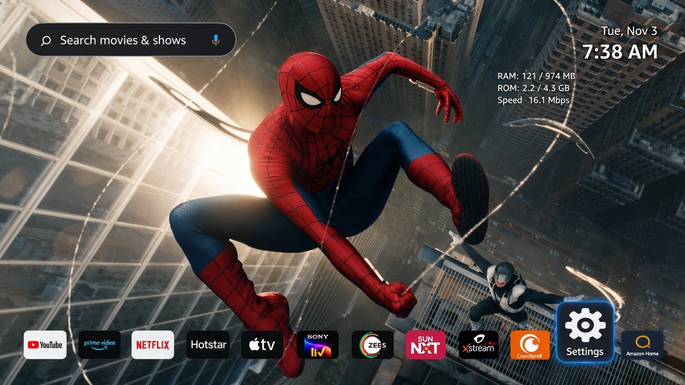
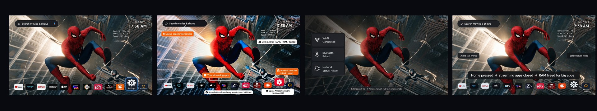
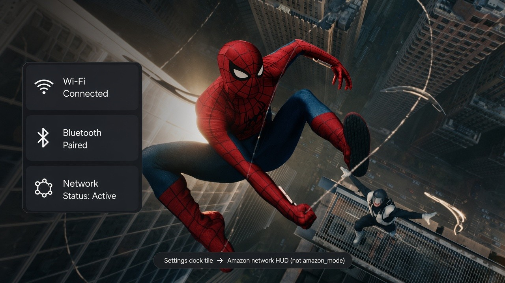
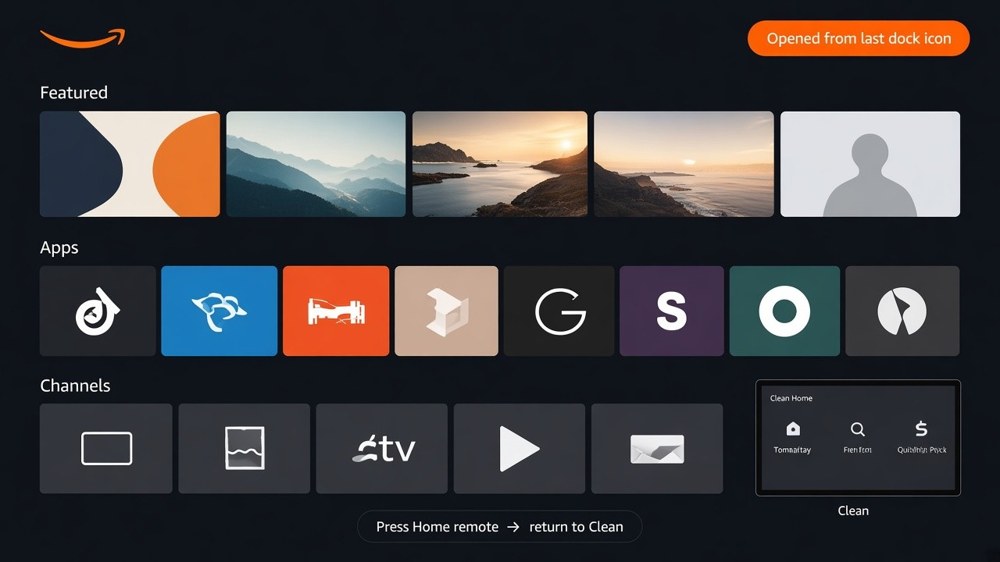
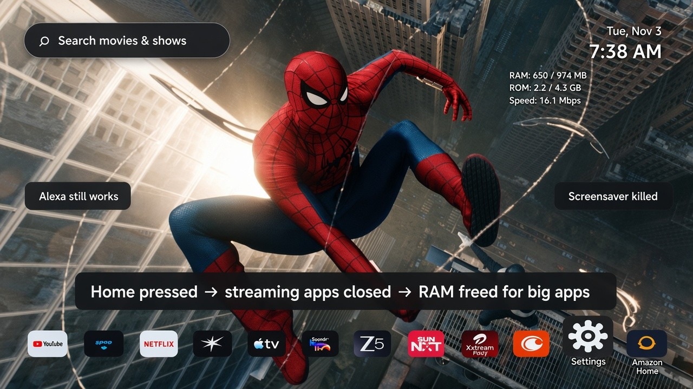
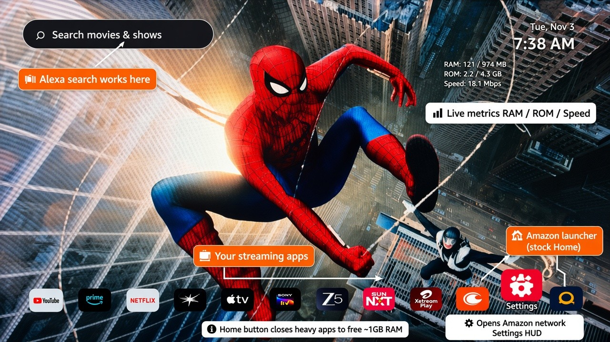
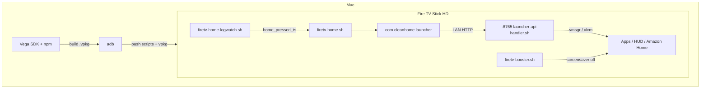

# 🚀 Clean Fire TV

<p align="center">
  
</p>

<p align="center">
  <a href="https://github.com/vishnubalachandran596/Clean-Fire-TV"></a>
  
  
  
  
</p>

<p align="center">
  <b>A fast, ad-light launcher</b> for <b>Amazon Fire TV Stick HD (Vega OS)</b> 🏠✨<br/>
  Minimal dock + your wallpaper · shell services that make <b>Home</b>, <b>Amazon</b>, and <b>Settings</b> behave · lean live metrics
</p>

<p align="center">
  
</p>

> ⚠️ **Not an official Amazon product.** Needs a developer-mode stick and the Vega SDK to build.  
> 📸 Gallery shots below are **generated UI mockups** referenced from a real Stick HD TV photo (not the raw photo itself).

---

## Why this “debloat” is different

Phone and tablet debloat usually means **root**, removing packages, or rewriting the system image. **Fire TV Stick HD on Vega is not that world.**

Amazon’s OS draws hard lines third-party apps cannot cross. There is no supported root path here. `/etc` is read-only. True first-party boot receivers are locked to Amazon. The React Native app sandbox often **cannot** talk to `127.0.0.1`, read other packages’ icon files, or quietly replace the system launcher the way Magisk modules do on Android. `journalctl` is blocked in the developer shell. HDMI-CEC and deep display sleep are not ours to fully disable. If a README promises “uninstall Amazon Home forever” or “one APK that roots the stick,” it is describing a different platform.

**Clean Fire TV accepts those limits and works around them instead of pretending they are gone.**

| OS / platform hard limit | What we do anyway |
|--------------------------|-------------------|
| No root / no rewriting the system image | Sideload a **launcher-category** Vega app + durable scripts under **`/data`** |
| App sandbox blocks reliable loopback HTTP | Bridge on **:8765**; RN uses **LAN IP** + `/data/cleanhome.bridge_ip` |
| Cannot scrape icons from other packages | Ship a **large bundled icon set** + map URLs the stick *can* fetch ([catalog](docs/ICON_CATALOG.md)) |
| No 1p-style boot receivers for 3p apps | Headless **boot task** + Task Manager schedule → `ensure-services` after reboot |
| Stock Home / smpl wants to stay in front | Soft handoff, `amazon_mode`, HomeKey / `loggingctl` watch → **`vmsgr` back to Clean** |
| System **default launcher is uneditable** | We cannot replace Amazon’s default; Clean is a launcher-category app you open |
| OS **`wakeOnCrash`** may bring stock Home after reboot | Soft reclaim when possible; if stock Home is up, **open Clean Home from the app list** (see below) |
| ~1 GB RAM, heavy streamers linger | **Home** (and optional booster) frees non-VISIBLE streaming apps — tunable |
| Screensaver / promo surfaces return | Force-stop screensaver from shell when Clean is the daily driver |

### What we achieved despite that

- A **usable daily Home**: wallpaper, square Appstore-style dock, Alexa search pill, light live metrics.
- **Your** apps first — not ad rows — with Settings → network HUD and Amazon Home still one tap away.
- **Home** that returns to Clean from Amazon mode and makes room for the next big app on a small stick.
- Services that **survive reboot** once `/data` scripts + the vpkg boot path are installed (Mac boost is for deploy, not every cold boot).
- Everything **tunable** — kill lists, amazon mode, metrics — documented so you can soften or harden behavior.

This will never be a full custom ROM. It is a practical compromise: **as clean as Vega allows**, measured against what the OS actually permits. If you are on Stick HD (Vega), stuck with ads and a crowded Home, and willing to use developer mode — **hope this helps.** Fork it, tune it, share what works on your stick.

---

## 📸 Screenshots (generated mockups)

<p align="center">
  
</p>

| 🏠 Clean Home | 📶 Network HUD | 🛒 Amazon Home | ↩️ Home return |
|:---:|:---:|:---:|:---:|
|  |  |  |  |

<p align="center">
  
</p>

**Annotated Clean Home (01b) — what each section does:**

| Section | What it does |
|---------|----------------|
| **Alexa search** | Search pill on Clean Home — Alexa still works through search |
| **Live metrics** | Date/time plus **RAM / ROM / Speed** while Clean is focused |
| **Streaming apps** | Rectangular dock tiles (artwork skewed to fill, not cropped) on `assets/wallpaper.jpg` — **88** bundled icons ([full list](docs/ICON_CATALOG.md)) |
| **Settings** | Opens the Amazon **network HUD** (Wi‑Fi / BT) — not a full Settings crawl |
| **Last dock icon** | **Amazon launcher** — stock Home when you want it (`amazon_mode`) |
| **Home** | Closes heavy streaming apps so **~1 GB sticks** free RAM for the next big app |

---

## ✨ Why Clean Fire TV?

| 🎯 Advantage | How it works |
|--------------|--------------|
| **No screensaver takeover** | `firetv-booster.sh` / `firetv-home.sh` force-stop `com.amazon.screensaver` |
| **Launcher stays warm** | Permanent lifespan so Home / metrics feel instant |
| **Lean default Home** | Prefer Clean over full Amazon Home until you choose Amazon |
| **Home frees RAM** 🧠 | On **Home**, streaming apps are terminated so **~1 GB sticks** stay snappy for the next heavy app (tunable — see [Decisions](#-decisions-we-took-change-anything)) |
| **Fast dock opens** | Bridge `/launch` + cooldown; booster **never kills VISIBLE** apps |
| **Amazon when you want** | Dock tile sets `amazon_mode`; **Home** returns to Clean |
| **Settings = network HUD** | Wi‑Fi / BT panel — not a full Settings crawl; **does not** set Amazon mode |
| **Light metrics** | ~1s refresh on launcher only; paused when another app is focused |
| **Reorderable dock** | Long-press / move mode; order persisted on device |
| **Survives Wi‑Fi IP change** | Bridge rediscovers LAN IP via `/data/cleanhome.bridge_ip` |
| **Scripts survive reboot** | Live under `/data`; package **headless boot task** + Task Manager schedule re-runs `ensure-services` (no Mac `boost-firetv.sh` required after install) |

**Honest limits:** see [Why this “debloat” is different](#why-this-debloat-is-different) above. Short version: we do **not** claim HDMI-CEC / full display-sleep control, root, deleting Amazon Home, or changing the OS **default launcher** (that setting is uneditable on Vega). We kill the **screensaver app**, keep Clean **permanent** when it is running, and clean **background streaming** on Home (unless you turn that off).

<a id="reboot-stock-home"></a>

### After reboot — stock Home sometimes appears

In **some** reboot cases the OS brings up Amazon’s default launcher (`smplighthouse`) because of **`wakeOnCrash`** / system default behaviour. The **system default launcher cannot be changed** from a third-party app, so Clean Home cannot guarantee it is always the first screen after power-on.

**What to do:** open the **app list**, find **Clean Home**, and launch it. Once Clean is VISIBLE, Home / dock behaviour works as usual. This is expected on Vega — not a failed install.

### 🧪 Felt difference (Stick HD class)

| Area | Stock-ish | Clean Fire TV |
|------|-----------|---------------|
| Launcher | Heavy home / promos | Dock + wallpaper |
| Idle | Screensaver / promos | Screensaver terminated |
| Metrics | Buried in Settings | Header when on Clean |
| After Home | Apps linger in RAM | Streamers closed → headroom for big apps |
| Home from Amazon | Often stuck on smpl | Logwatch + `vmsgr` → Clean |

---

## 🗺️ Architecture (short)



**📚 Docs (humans & AIs)**

| Doc | Purpose |
|-----|---------|
| [docs/SETUP_FROM_SCRATCH.md](docs/SETUP_FROM_SCRATCH.md) | Amazon account → Vega CLI → install |
| [docs/ARCHITECTURE_AND_FINDINGS.md](docs/ARCHITECTURE_AND_FINDINGS.md) | Hard rules (VISIBLE, bridge IP, amazon_mode, tools) |
| [docs/STICK_LAYOUT.md](docs/STICK_LAYOUT.md) | `/data` paths & processes |
| [docs/PUBLISH.md](docs/PUBLISH.md) | Push with git + SSH |
| [AGENTS.md](AGENTS.md) | Instructions for coding agents |
| [docs/images/](docs/images/) | README screenshots |

---

## 🧭 Step-by-step setup (with references)

Follow these in order. Full narrative: [docs/SETUP_FROM_SCRATCH.md](docs/SETUP_FROM_SCRATCH.md).

### Step 1 — Stick & ADB 🔌

1. [Amazon Developer](https://developer.amazon.com/) account.
2. Enable **developer mode** + **ADB** on the Fire TV Stick HD (Vega OS).
3. Note LAN IP (Settings → Network / router).

```bash
adb connect <STICK_IP>:5555
adb devices   # must show device
```

### Step 2 — Mac toolchain 🧰

1. Install **Vega / Kepler SDK** (Amazon docs for your SDK version) → `vega` / `vtbuild` on `PATH`.
2. **Node ≥ 20**, Android **platform-tools** (`adb`).

### Step 3 — Clone & build 📦

```bash
git clone git@github.com:vishnubalachandran596/Clean-Fire-TV.git
cd Clean-Fire-TV
npm install
npm run build:release
```

Typical armv7 package (Stick HD):

`build/private/kepler/@amazon-devices/leanlauncher/0.1/vega/armv7/Release/@amazon-devices/leanlauncher_armv7.vpkg`

### Step 4 — Push shell services to `/data` 🐚

One-shot (preferred):

```bash
chmod +x boost-firetv.sh
./boost-firetv.sh <STICK_IP>
```

Or manual map → see [docs/STICK_LAYOUT.md](docs/STICK_LAYOUT.md) and [docs/SETUP_FROM_SCRATCH.md](docs/SETUP_FROM_SCRATCH.md) §4.

| Host | Stick | Role |
|------|-------|------|
| `scripts/launcher-api-handler.sh` | `/data/launcher-api-handler.sh` | HTTP **:8765** bridge |
| `scripts/firetv-home.sh` | `/data/firetv-home.sh` | Default Home + streaming kill on Home |
| `scripts/firetv-home-logwatch.sh` | `/data/firetv-home-logwatch.sh` | Async Home via `loggingctl` |
| `scripts/firetv-booster.sh` | `/data/firetv-booster.sh` | Screensaver + background cleanup |
| `scripts/start-booster.sh` | `/data/start-booster.sh` | Full restart |

### Step 5 — Install the vpkg 📲

```bash
adb -s <STICK_IP>:5555 push \
  build/private/kepler/@amazon-devices/leanlauncher/0.1/vega/armv7/Release/@amazon-devices/leanlauncher_armv7.vpkg \
  /tmp/leanlauncher_armv7.vpkg
adb -s <STICK_IP>:5555 shell 'vpm install /tmp/leanlauncher_armv7.vpkg --force; vmsgr send pkg://com.cleanhome.launcher.main'
```

Install also runs `com.cleanhome.launcher.onInstallOrUpdateTask`, which schedules the durable
headless boot task (`com.cleanhome.launcher.boot`). After that, **reboot should not need**
Mac `boost-firetv.sh` as long as `/data/*.sh` remain.

### Step 6 — Verify ✅

```bash
adb -s <STICK_IP>:5555 shell '
  curl -s http://127.0.0.1:8765/ping
  curl -s http://127.0.0.1:8765/screen-stats-fast
  vlcm list | grep -E "cleanhome|VISIBLE"
'
```

**Boot / ensure without full reboot** (strongest non-disruptive test):

```bash
adb -s <STICK_IP>:5555 shell '
  # Kill stack
  ps -ef | grep -E "firetv-home|firetv-booster|logwatch|cleanhome-supervisor|8765" | grep -v grep | awk "{print \$2}" | xargs -r kill -9
  sleep 1
  # Trigger package boot component (same path used after reboot by Task Manager)
  vmsgr send pkg://com.cleanhome.launcher.boot
  sleep 3
  curl -s http://127.0.0.1:8765/ping
  ps -ef | grep -E "firetv-home|firetv-booster|logwatch|8765|supervisor" | grep -v grep
'
```

Smoke flows: dock app → Settings HUD → Amazon tile → **remote Home** → Clean VISIBLE again.

> 📌 **Reboot tip:** If Amazon’s default Home is showing after reboot (`wakeOnCrash` / uneditable system default), just pick **Clean Home** from the app list and open it. Details: [After reboot — stock Home sometimes appears](#reboot-stock-home).

<a id="first-setup-icons"></a>

### Step 7 — First-setup icons (do this on the TV) 🖼️

Clean Home ships a **good collection of 88 bundled icons** (streaming, VPNs, Jellyfin/Emby/Kodi, and more) — full list in **[docs/ICON_CATALOG.md](docs/ICON_CATALOG.md)**. Live `iconUrl` from the bridge fills gaps when CDN works. On a **new stick**, plan for this once:

1. **Connect the stick to the internet** (Wi‑Fi). Remote icons load from `m.media-amazon.com` when mapped — without network, **bundled** icons still show.
2. **Install the apps you want** on the TV (Prime Video, Netflix, YouTube, Hotstar, VPN, Jellyfin, etc.) before expecting a full dock. The live list comes from `vpm` via `GET /apps`.
3. **Open Clean Home once** after install so it can fetch `/apps` and apply artwork for known packages.
4. **Apps without a bundled / mapped icon** still show on the dock with a **title tile**. To add art for a new package:
   - Drop a ~512² PNG at `assets/icons/<packageId>.png`
   - Map it in `BUNDLED_ICONS` (`src/App.tsx`) and update [docs/ICON_CATALOG.md](docs/ICON_CATALOG.md)
   - Add an Appstore CDN URL in `icon_url_for_pkg` (`scripts/launcher-api-handler.sh`) when you have one
   - Rebuild the vpkg + `./boost-firetv.sh <STICK_IP>`
5. **Seed / reorder:** long-press a tile to rearrange; order is saved on device. Until `/apps` succeeds, a **local seed list** (Prime, Netflix, … + Settings / FireTV) keeps the dock usable.

> ⚠️ Package filesystem icons are **not** readable from the Vega app sandbox. Do not rely on extracting icons from `/pkgs` — use bundled PNGs + the bridge map above.

---

## 🧠 Decisions we took (change anything)

These are **product choices**, not OS laws. Every user can tune them.

| Decision | Why | Where to change | Soften / remove |
|----------|-----|-----------------|-----------------|
| **Home closes streaming apps** 🧹 | Frees RAM so the **next** heavy app (even on **~1 GB** sticks) starts faster | `STREAM_KILL` in `scripts/firetv-home.sh` (`kill_streaming_on_home`) | Empty `STREAM_KILL=""` or delete the `kill_streaming_on_home` call in `exit_amazon_to_clean` / Home paths; redeploy `./boost-firetv.sh <IP>` |
| **Booster kills non-VISIBLE streamers** when Clean is focused | Keeps idle RAM low without killing the app you just opened | `STREAM_BG` in `scripts/firetv-booster.sh` | Empty list or comment out `kill_background_streaming` |
| **Always kill screensaver** | No promo takeover | both home + booster | Remove `com.amazon.screensaver` kills (you’ll see Amazon screensaver again) |
| **Settings → network HUD only** | Fast Wi‑Fi/BT; avoid Amazon mode | `/network-panel` in `launcher-api-handler.sh` | Point Settings tile at another component in `App.tsx` + handler |
| **Amazon tile sets `amazon_mode`** | Stock Home works until you press Home | `/amazon-home` | Don’t use the tile, or clear `/data/cleanhome.amazon_mode` |
| **Bridge prefers LAN IP** | App sandbox often can’t `fetch` loopback | `src/bridge.ts`, `/data/cleanhome.bridge_ip` | Keep seed + 1s refresh; see findings doc |
| **`grep -qw VISIBLE`** | Bare `VISIBLE` matches `NOT_VISIBLE` | all shell | Don’t “simplify” this |
| **`loggingctl` not `journalctl`** | journalctl blocked on Vega shell | `firetv-home-logwatch.sh` | Don’t switch back |
| **Metrics ~1s, pause off-launcher** | Cheap HUD without starving launches | `App.tsx` + `/screen-stats-fast` | Slow interval or hide panel |
| **Permanent launcher lifespan** | Home feels instant | `manifest.toml` | Change lifespan if you prefer ephemeral |
| **Wallpaper + icon stretch** | Brand-first dock | `assets/wallpaper.jpg`, `assets/icons/`, `App.tsx` | Swap assets & rebuild |

> 💡 After **any** script edit: `./boost-firetv.sh <STICK_IP>` (no full app rebuild). After UI / assets: `npm run build:release` + `vpm install`.

Hard-won rules (don’t regress): [docs/ARCHITECTURE_AND_FINDINGS.md](docs/ARCHITECTURE_AND_FINDINGS.md) · agent checklist: [AGENTS.md](AGENTS.md).

---

## 🤖 Use this repo with Claude, Cursor, ChatGPT, Copilot, …

Point any coding agent at the **clone** and the **entry docs** so it doesn’t reinvent broken patterns.

### A) One-time clone (all tools)

```bash
git clone git@github.com:vishnubalachandran596/Clean-Fire-TV.git
cd Clean-Fire-TV
```

HTTPS alternative:

```bash
git clone https://github.com/vishnubalachandran596/Clean-Fire-TV.git
cd Clean-Fire-TV
```

### B) Claude Code (CLI) 🟣

```bash
cd Clean-Fire-TV
claude
```

Or start in this folder from elsewhere:

```bash
claude --cwd /path/to/Clean-Fire-TV
```

**Paste this as your first prompt** (or add to a Claude Project instruction):

```text
You are helping on Clean Fire TV (Vega / Fire TV Stick HD launcher).

Before changing launcher, bridge, Home, Amazon mode, Settings HUD, or deploy scripts, READ in order:
1) AGENTS.md
2) docs/ARCHITECTURE_AND_FINDINGS.md
3) docs/SETUP_FROM_SCRATCH.md
4) docs/STICK_LAYOUT.md
5) README.md (Decisions we took)

Hard rules:
- Prefer shell on /data + vmsgr send for launches.
- Use grep -qw VISIBLE (never bare grep VISIBLE).
- Do NOT set amazon_mode for /network-panel.
- Home detection: loggingctl + vlcm HomeKey — not journalctl.
- Bridge: LAN IP + /data/cleanhome.bridge_ip + 1s refresh; loopback alone is insufficient for the RN app.
- Home may kill STREAM_KILL apps on purpose (RAM for ~1GB sticks) — ask before removing unless I request it.
- After script edits: ./boost-firetv.sh <STICK_IP> and verify with vlcm list + curl :8765 from adb shell.

Required step — dock apps + original icons (follow AGENTS.md):
- List installed apps from BOTH kepler.media and category.main (Crunchyroll / Xstream / Music often miss media-only).
- Ensure curl :8765/apps lists every installed user app with m.media-amazon.com iconUrl.
- Update launcher-api-handler.sh (icon_url_for_pkg + list_apps), App.tsx BUNDLED_ICONS/SEED_MEDIA_APPS,
  assets/icons/<packageId>.png, STREAM_KILL/STREAM_BG; then boost + rebuild vpkg.

My stick IP is: <STICK_IP>
Task: <describe what you want>
```

Optional Project knowledge: upload / link `AGENTS.md` + `docs/ARCHITECTURE_AND_FINDINGS.md`.

### C) Cursor 🩵

1. **File → Open Folder** → `Clean-Fire-TV`.
2. Agent chat already picks up `.cursor/rules/firetv-clean-home.mdc` + `AGENTS.md`.
3. First message can be short:

```text
Follow AGENTS.md + docs/ARCHITECTURE_AND_FINDINGS.md.
Stick: <STICK_IP>. Task: <…>
```

### D) ChatGPT / Claude.ai (web) with zip or GitHub

1. Clone locally (section A) **or** download ZIP from GitHub.
2. Start a chat / Project; attach or upload at least:
   - `AGENTS.md`
   - `docs/ARCHITECTURE_AND_FINDINGS.md`
   - `README.md`
3. Paste the **same prompt block** from section B.

### E) GitHub Copilot Chat / VS Code

1. Open the cloned folder in VS Code.
2. Copilot Chat → `@workspace` + paste the prompt block from B (shorten if needed).
3. Prefer asking Copilot to **read `AGENTS.md` first**.

### F) Continue / Aider / other CLI agents

```bash
cd Clean-Fire-TV
# example: aider
aider --read AGENTS.md docs/ARCHITECTURE_AND_FINDINGS.md README.md
```

Always tell the agent: **scripts live on `/data` after deploy**; Mac `scripts/` is the source of truth.

---

## 🎨 Customize

### Wallpaper

1. Replace **`assets/wallpaper.jpg`** (same name, or update `require` in `src/App.tsx`).
2. Prefer **1920×1080** JPEG.
3. Rebuild + reinstall vpkg (see Step 5).

### Icons & dock apps

Clean Home ships a **good collection of 88 bundled app icons** (streaming, **VPNs**, **Jellyfin**/Emby/Kodi/Plex, sports, free TV, and more). Rectangular dock tiles **skew** artwork with `resizeMode="stretch"` (fills the tile — not cropped).

- **Full list (names + package IDs):** **[docs/ICON_CATALOG.md](docs/ICON_CATALOG.md)**
- **Files:** `assets/icons/<packageId>.png` · wired in `BUNDLED_ICONS` (`src/App.tsx`)
- **URL map for live `/apps`:** `icon_url_for_pkg` in `scripts/launcher-api-handler.sh` (+ `assets/icons/asin_icon_urls.json`)
- Prefer `m.media-amazon.com/images/I/…` when available — the old ads-system widget URL does **not** load on-device
- Seed dock until `/apps` returns: `SEED_MEDIA_APPS` / `SEED_DOCK_APPS` in `src/App.tsx`
- Live list: bridge `GET /apps` → `buildDockFromRemote`; long-press to reorder
- First TV setup: see [Step 7 — First-setup icons](#first-setup-icons)

### Branding

- Package title: `manifest.toml` → `[package].title`
- On-screen strings: `src/App.tsx`

### Shell behaviour

- Kill lists / Home: `scripts/firetv-home.sh`, `scripts/firetv-booster.sh`
- Redeploy scripts only: `./boost-firetv.sh <STICK_IP>`

---

## 🔌 Bridge API (on stick)

```bash
curl -s http://127.0.0.1:8765/ping
curl -s http://127.0.0.1:8765/screen-stats-fast
curl -s http://127.0.0.1:8765/launch/com.netflix.kepler.main
curl -s http://127.0.0.1:8765/amazon-home
curl -s http://127.0.0.1:8765/network-panel
curl -s http://127.0.0.1:8765/home-to-clean
```

RN app must use the stick **LAN IP** (seeded at deploy + `/data/cleanhome.bridge_ip`), not only `127.0.0.1`.

---

## 📁 Repo layout

```text
assets/wallpaper.jpg   # Default background (customize me)
assets/icons/          # Dock icons (see docs/ICON_CATALOG.md)
docs/ICON_CATALOG.md   # Full bundled icon list (88 apps)
src/                   # React Native / Kepler UI
scripts/               # On-stick shell (→ copy to /data)
docs/                  # Setup + architecture + images/
boost-firetv.sh        # One-shot script deploy
manifest.toml          # Vega package manifest
AGENTS.md              # AI agent entrypoint
.cursor/rules/         # Cursor always-on rule
```

---

## 🔮 Future ideas

- Optional sleep / HDMI policy docs  
- Icon packs / profiles (kid / night)  
- Auto-fetch Appstore icons for **new** packages (no manual `icon_url_for_pkg` edit)  
- Tighter HomeKey detection  
- Selective booster allowlists  
- CI `vpkg` build on a Vega runner  
- First-run wallpaper / icon wizard on the TV  

PRs welcome 💜

---

## 🛡️ Safety / scope

- Third-party sideload; OS updates can break behaviour.
- The OS **default launcher is uneditable**. After some reboots, stock Home may appear via **`wakeOnCrash`** — open **Clean Home** from the app list ([details](#reboot-stock-home)).
- Screensaver + Home streaming cleanup are **aggressive by design** — edit kill lists if you want gentler behaviour.
- No Amazon credentials or device serials in this repo.

## 📜 License

MIT — see [LICENSE](LICENSE).

---

<p align="center">
  
  
</p>

<p align="center">
  <b>Learn more at</b><br/>
  <a href="https://vishnubalachandran.com"></a>
</p>

<p align="center">
  <a href="https://vishnubalachandran.com">https://vishnubalachandran.com</a> 🌐😊
</p>
