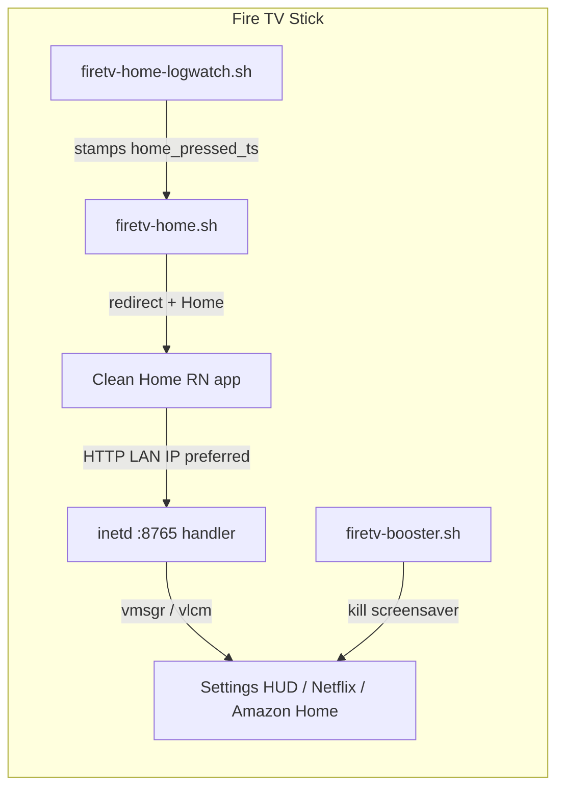

# Architecture, findings, and rules for future changes

## What Clean Home is

A Vega (Kepler / React Native) **launcher-category** app plus **on-device shell daemons**. The UI cannot reliably launch other apps or clear Amazon mode alone; the shell bridge and home scripts do the privileged work (`vmsgr` / `vlcm`).

## Critical findings (do not regress)

### 1. Bridge host: do not hardcode DHCP forever; do not rely on loopback alone

- RN `fetch('http://127.0.0.1:8765')` often **fails** in the app sandbox.
- LAN `http://<stick-ip>:8765` works.
- Pattern: write `/data/cleanhome.bridge_ip` from shell; seed `BRIDGE_IP_SEED` at deploy; refresh host every **1s** in `src/bridge.ts`.
- Prefer **word-boundary** checks: `grep -qw VISIBLE` — plain `grep VISIBLE` matches **`NOT_VISIBLE`**.

### 2. Amazon mode vs network HUD

- **Amazon Home** dock → `GET /amazon-home` → sets `/data/cleanhome.amazon_mode`, opens smpl.
- **Settings** dock → `GET /network-panel` → opens `com.amazon.vegatvsettings.hud` — **must not** set amazon_mode.

### 3. Home from Amazon

- Background Clean may get `homePressed`, but bridge fetch can fail (CURL errors).
- Reliable path: shell watches **HomeKey / launchReason=Home** on `vlcm list`, plus **async** `loggingctl` (`firetv-home-logwatch.sh`) writing `home_pressed_ts`.
- **`journalctl` does not work** in Vega developer shell — use **`loggingctl`**.
- Returning Clean: always **`vmsgr send pkg://com.cleanhome.launcher.main`**, not only `vlcm trigger-app foreground` (foreground alone loses to smpl).

### 4. Dock app launches vs booster

- Booster must **never kill VISIBLE** streaming apps.
- Set `/data/cleanhome.launch_cooldown` on `/launch` so kills pause while the target becomes VISIBLE.
- Never use RN `SoundManager` (aborts this Vega build). Nav tick is **lazy** in `src/navSound.ts`: bundled `assets/sounds/nav-tick.wav` via `AudioPlayer`, fallback `AudioManager.playSystemSoundAsync(CLICK)`, permanent silence on any failure. Do not await sound before `/launch`.

### 5. Shell / tools discipline

- Prefer **`sh` scripts on `/data`** + `setsid` for daemons.
- Bridge via **`systemd-socket-activate -l 8765 -a --inetd`**.
- Launch with **`vmsgr send`** first; fall back `vmsgr launch-app` / `vlcm`.
- Debugging: `vlcm list`, `vpm info`, `curl` to `127.0.0.1:8765` from **adb shell** (shell localhost works; app may need LAN IP).
- Keep scripts **idempotent**; supervisor restarts missing processes.

### 5b. Boot without Mac `boost-firetv.sh`

- `/etc` is erofs — no systemd unit drop-ins for 3p apps.
- Vega **`run-after-boot`** privilege is **1p-only**; third-party apps cannot register true boot receivers.
- Durable path: headless task `com.cleanhome.launcher.boot` + install task that schedules it via Task Manager (`persistAfterAppDeath` + repeating ~120s) using privilege `com.amazon.background-tasks.privilege.run`.
- Native Turbo Module `CleanHomeShell` shells out to `/data/ensure-services.sh` (no-op / soft-fail if scripts missing).
- Do **not** set `amazon_mode` from boot/ensure paths meant for network HUD.

### 6. Performance notes (observed)

| Area | Approach | Effect |
|------|----------|--------|
| Metrics | `/screen-stats-fast` every 1s when launcher active; pause when blurred | Metrics without blocking `/launch` |
| App size | Dropped unused Wi‑Fi/BT name modules from RN | Smaller / simpler package |
| Home detect | Async logwatch + fast `vlcm` poll in amazon mode | Home works without blocking the main loop on loggingctl |
| Streaming cleanup | Only non-VISIBLE packages + launch cooldown | Dock opens stay open |

## Future change checklist

1. Change UI launch? Update **both** `App.tsx` `openApp` and `launcher-api-handler.sh`.
2. Touch Home/Amazon? Re-test: Amazon Home → Home → Clean VISIBLE; confirm `amazon_mode` file lifecycle.
3. Touch metrics? Never call slow `/screen-stats` (pings) from the 1s poll.
4. After DHCP change: redeploy seed via `boost-firetv.sh <new-ip>` or rely on `/data/cleanhome.bridge_ip` + 1s refresh.
5. `build-number` is required by Vega — sideload flip **`1` ↔ `2`** only (`vpm install --force`); never climb 47→51→…. Never commit real LAN IPs as permanent secrets (seed is overwritten at deploy).
